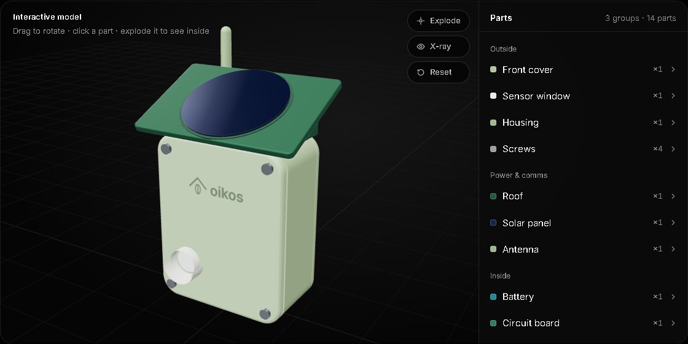
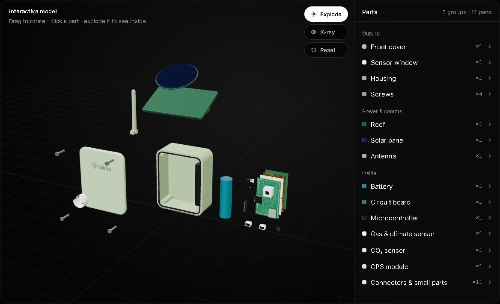
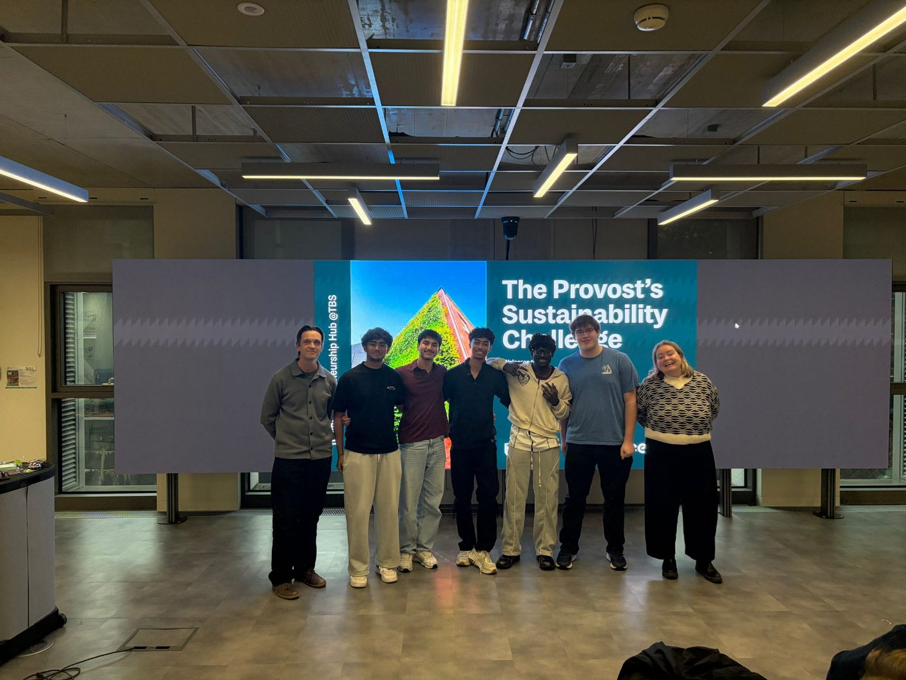

# Oikos

**🥈 2nd place at the Provost’s Sustainability Challenge** (Trinity Entrepreneurship Hub, with Zeeus · Trinity College Dublin · 24 October 2026)

Oikos (Greek for “household”) is a small, solar-powered detector that sits out on the hills, senses a wildfire while it’s still small, and sends an alert to someone who can act. Our team of five designed it, built a working prototype and pitched it to the judges in one day.

**[Try the interactive 3D model →](https://anish-achar.github.io/oikos/model/)** · [Full write-up on anishachar.com](https://anishachar.com/#projects/oikos)

## The problem

Fires on Ireland’s hills spread in minutes, on land that nobody is watching.

| | | Source |
|---|---|---|
| **2,300–2,800** | wildfires a year in Ireland | UCC, *Investigating the impact of wildfires in Ireland* (2022) |
| **Up to half** | of Killarney National Park burned in three days, 2021 | Dept. of Housing estimate, via TheJournal.ie |
| **25×** | more land burnt by large fires in 2025 than 2024 (200 → 5,013 ha) | EFFIS (fires over 30 ha only) |
| **64%** | of Ireland’s soil carbon is in peatlands, released when they burn | EPA, *Ireland’s Environment 2020* |

It’s close to home for us: in August 2025 a gorse fire burned on the hills at Ticknock in Dublin, next to where we live, and black smoke rose for at least a week.

## How it works

1. **Sense.** Sensors watch the air around the detector for the heat, gases and rise in CO₂ that a fire gives off.
2. **Judge the risk.** The microcontroller works out a Fire Weather Index from its readings and Met Éireann’s rain and wind data.
3. **Send it.** Each reading goes over the mobile network (LTE) to a server, tagged with GPS, so it works on hills with no Wi-Fi.
4. **Alert someone.** A live dashboard shows every detector, and a phone alert reaches someone who can act while the fire is still small.

## The design

The case has a sealed front cover, a sloped roof that sheds rain and holds the solar panel, an antenna, a rechargeable battery and one circuit board carrying the sensors.

- [`model/`](model/) is the interactive viewer: rotate it, click any of its 14 parts, explode it or see through the case. It’s a simplified rebuild of our team’s CAD in three.js (self-hosted, no outside requests).
- [`media/cad-explode.mp4`](media/cad-explode.mp4) is our team’s original CAD render from the pitch.

## The working prototype

For the live demo, a lighter flame next to the prototype showed up on our live dashboard and a phone got the alert. It runs on the sensor station Luka first built for his Leaving Cert Computer Science project:

- Pimoroni Pico LiPo 2 W microcontroller, programmed in MicroPython
- BME688 gas and climate sensor, and SCD-30 CO₂ sensor
- GPS, an LTE modem with a SIM, and an SD card
- A Python Flask server with a database that stores the readings and shows them on a web page

Luka’s write-up of the hardware: [lccs.lcvetkovic.com](https://lccs.lcvetkovic.com/create.html)

## The team

| | Role |
|---|---|
| **Anish A** | Lead presenter & researcher |
| **Adarsh A** | Engineer: CAD model and working prototype |
| **Luka C** | Engineer: CAD model and working prototype |
| **Nihal M** | Market research |
| **Tanmai H** | Market research |

More photos from the day are in [`photos/`](photos/).

## Honest caveats

- We built it in a day. The case is a CAD concept and the live demo ran on a breadboard prototype, so Oikos hasn’t been tested out on a hillside yet.
- A lighter held next to the sensors is a much easier test than a real fire some distance away. How far one detector can sense a fire is still to be measured.
- The 3D model is a simplified rebuild made in code (with Claude), not the CAD file itself. Its part names follow the working prototype’s hardware.

## Credits

three.js is © the three.js authors, MIT licence (see `model/vendor/three/LICENSE.txt`). The Inter font is under the SIL Open Font License 1.1. Product names belong to their owners.
